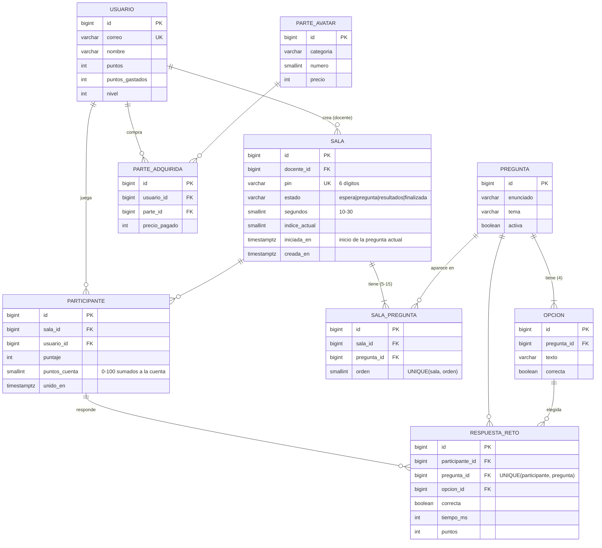

# Reto en vivo · documentación técnica

Implementación del requerimiento avanzado **«Reto multijugador en vivo con QR dinámico»**
(documento técnico de Octubre de 2026). Todo el código está en la app **`vivo/`**.

## 0. Avance según el cronograma (sección 8 del documento)

| Semana | Actividad | Estado |
|---|---|---|
| 1 | Modelos, rol docente, Channels + Redis desplegados | ✅ `vivo/models.py`, grupo «Docentes» (migración `0002` + botón en el panel), `config/asgi.py`, Daphne + Render Key Value |
| 2 | Crear sala, QR dinámico, unirse y sala de espera en vivo | ✅ RF-02, RF-03, RF-04 |
| 3 | Preguntas sincronizadas, validación, puntaje y ranking | ✅ RF-05, RF-06, RF-07 (ranking y podio con avatares) |
| 4 | Reconexión, puntos a la cuenta, pruebas, informe y video | ✅ RF-08, RF-09, 31 pruebas del reto + prueba de carga · ⏳ **informe y video** (los preparan los integrantes) |

**Entregables:** código en GitHub ✅ · aplicación desplegada ✅ · DER actualizado ✅ (sección 3) ·
diagrama de secuencia ✅ (sección 4) · video de 3 a 5 min con al menos 5 celulares ⏳.

## 1. Requerimientos y dónde se cumplen

| ID | Requerimiento | Implementación | Prueba (`vivo/tests.py`) |
|---|---|---|---|
| RF-01 | Rol docente | Grupo «Docentes» creado por la migración `0002`; `es_docente()` en `models.py`. Se asigna desde **Panel → Usuarios → Docente** o `/admin/`. Los superusuarios también pueden crear salas. | `test_solo_docentes_crean_salas`, `test_panel_hace_docente` |
| RF-02 | Crear sala | `CrearSalaForm` (5–15 preguntas, 10–30 s) y `servicios.crear_sala()` (preguntas al azar, PIN de 6 dígitos único). | `test_crear_sala`, `test_limites_de_la_sala` |
| RF-03 | QR dinámico | `views.qr_sala`: token `django.core.signing` con marca de tiempo → SVG con `qrcode`. La pantalla del docente pide uno nuevo cada **5 min**; `views.unirse` lo acepta hasta **10 min** (`max_age=600`). El PIN es la alternativa (`unirse_pin`). | `test_qr_de_hace_11_minutos_esta_vencido`, `test_token_alterado_se_rechaza`, `test_unirse_con_pin` |
| RF-04 | Unirse | Sin sesión → login/registro con `?next=` que conserva el token → `Participante` → sala de espera. El docente recibe el evento `lobby` con la lista. | `test_sin_sesion_pide_login_y_conserva_el_token`, `test_registro_vuelve_al_qr` |
| RF-05 | Pregunta sincronizada | «Siguiente» → `abrir_siguiente_pregunta()` guarda `iniciada_en` y difunde la pregunta **sin** el campo `correcta`; las opciones se guardan y se envían en orden aleatorio para que el id no delate la respuesta. | `test_la_pregunta_no_lleva_la_respuesta` |
| RF-06 | Puntaje en el servidor | `registrar_respuesta()`: transacción con `select_for_update`, tiempo medido en el servidor, `Puntos = 1000 × (1 − 0,5 × t/T)`; rechaza tardías y repetidas (`UniqueConstraint una_respuesta`). | `test_formula_de_puntaje`, `test_responder_dos_veces_se_rechaza`, `test_respuesta_tardia_se_rechaza` |
| RF-07 | Ranking en vivo | `cerrar_y_rankear()` (idempotente): respuesta correcta, aciertos y top 5 **con el avatar personalizado de cada jugador**; cada estudiante recibe además su propio resultado. Al final, `podio` (también con avatares). | `test_resultados_y_ranking` |
| RF-08 | Reconexión | Al conectar, el consumidor envía `estado_actual()`: pregunta abierta con **tiempo restante**, si ya respondió y su puntaje. El cliente reintenta con espera exponencial (1, 2, 4… 10 s). | `test_reconexion_recupera_pregunta_tiempo_y_puntaje`, `test_flujo_en_vivo` |
| RF-09 | Puntos a la cuenta | `_finalizar()`: puntaje escalado a máximo 100 sobre las preguntas jugadas → `Usuario.sumar_puntos()` (nivel e insignias). Solo ocurre una vez. | `test_partida_completa_suma_puntos_a_la_cuenta_una_vez` |

## 2. Archivos nuevos o modificados

```
vivo/                         ← app nueva
├── models.py                 Pregunta, Opcion, Sala, SalaPregunta, Participante, RespuestaReto
├── servicios.py              toda la lógica de la partida (síncrona, fácil de probar)
├── consumers.py              RetoConsumer (WebSocket)
├── routing.py                ws/vivo/<pin>/
├── views.py · urls.py        crear sala, QR, unirse, pantallas
├── forms.py · admin.py
├── migrations/0001_inicial.py, 0002_banco_y_docentes.py   (23 preguntas + grupo «Docentes»)
├── templates/vivo/           inicio, docente (proyector), estudiante (celular), qr_vencido
└── tests.py                  31 pruebas
static/js/reto-vivo.js        cliente: WebSocket nativo, reconexión, temporizador, avatares en ranking y podio
static/img/boton-pez.png      botón del menú en celulares (reemplaza el ícono de tres rayas, que no se veía)
static/css/mision-oceano.css  estilos .mo-reto-*
config/asgi.py                ProtocolTypeRouter + AuthMiddlewareStack + AllowedHostsOriginValidator
config/settings.py            daphne, channels, vivo, CHANNEL_LAYERS (REDIS_URL)
panel/                        botón «Docente» y filtro por docentes
usuarios/                     el registro también respeta ?next= (para volver al QR)
templates/base.html           enlace «Reto en vivo»
scripts/prueba_carga.py       prueba de carga con N jugadores simulados
render.yaml · DESPLIEGUE_RENDER.md
```

## 3. Diagrama entidad-relación (actualizado)



GitHub dibuja este diagrama automáticamente. Para exportarlo como imagen: pegar el bloque en
<https://mermaid.live> → *Actions* → PNG/SVG.

## 4. Diagrama de secuencia de una pregunta

```mermaid
sequenceDiagram
    autonumber
    actor D as Docente (proyector)
    participant WS as Daphne · RetoConsumer
    participant R as Redis (grupo reto_PIN)
    participant DB as PostgreSQL
    actor E as Estudiantes (celulares)

    D->>WS: {"tipo":"siguiente"}
    WS->>DB: abrir_siguiente_pregunta() · estado=pregunta, iniciada_en=ahora
    DB-->>WS: pregunta + opciones (sin «correcta»)
    WS->>R: group_send(pregunta)
    R-->>D: pregunta + temporizador
    R-->>E: pregunta + temporizador (4 botones)
    Note over WS: asyncio.create_task(cerrar_al_vencer) → segundos + 1

    E->>WS: {"tipo":"responder","pregunta":id,"opcion":id}
    WS->>DB: registrar_respuesta() · transacción + select_for_update<br/>tiempo medido en el servidor, puntos = 1000×(1−0,5·t/T)
    alt dentro del tiempo y primera vez
        DB-->>WS: aceptada
        WS-->>E: respuesta_recibida (sin decir si acertó)
        WS->>R: group_send(conteo)
        R-->>D: «N de M respuestas»
    else tarde / repetida / pregunta cerrada
        WS-->>E: rechazada (motivo)
    end

    alt vence el tiempo
        WS->>DB: cerrar_y_rankear(pin, índice)
    else el docente pulsa «Cerrar»
        D->>WS: {"tipo":"cerrar"}
        WS->>DB: cerrar_y_rankear(pin)
    end
    DB-->>WS: correcta, aciertos, top 5 (solo la 1.ª llamada; las demás → None)
    WS->>R: group_send(resultados)
    R-->>D: respuesta correcta + top 5
    R-->>E: respuesta correcta + top 5 + su resultado (+puntos, puesto)
```

**Reconexión:** si un celular pierde la señal, `ws.onclose` reintenta (1 s, 2 s, 4 s… máx. 10 s).
Al volver a conectar, `connect()` le envía `estado_actual()`: la pregunta abierta con el tiempo que
**queda** (calculado en el servidor), si ya respondió y su puntaje. Si el docente estuvo
desconectado y el tiempo ya venció, la primera conexión que llegue cierra la pregunta
(`cerrar_si_vencida`).

## 5. Pruebas mínimas del documento (sección 7)

| Prueba pedida | Cómo se verificó |
|---|---|
| QR de hace 11 minutos → «QR vencido» | `test_qr_de_hace_11_minutos_esta_vencido` |
| Token con un carácter alterado → rechazado | `test_token_alterado_se_rechaza` |
| Responder dos veces la misma pregunta → la segunda se rechaza | `test_responder_dos_veces_se_rechaza` y por WebSocket en `test_flujo_en_vivo` |
| Respuesta enviada a mano después del tiempo → «tiempo agotado» | `test_respuesta_tardia_se_rechaza` |
| Inspeccionar los mensajes del WebSocket → no aparece la respuesta correcta | `test_la_pregunta_no_lleva_la_respuesta`, `test_flujo_en_vivo`. A mano: DevTools → *Network* → *WS* → mensajes. |
| Modo avión 5 s y volver → sigue en la partida con su puntaje | `test_reconexion_recupera_pregunta_tiempo_y_puntaje`, `test_flujo_en_vivo` (desconecta y reconecta). A mano con el celular. |
| Prueba de carga: 30 conexiones | `scripts/prueba_carga.py --jugadores 30`. Local con Daphne + Redis + PostgreSQL: 30/30 conectados, 150/150 respuestas aceptadas, 0 errores. |

```bash
python manage.py test vivo          # solo el reto en vivo
python manage.py test               # todo el proyecto
```

## 6. Banco de preguntas

La migración `0002_banco_y_docentes` carga 23 preguntas (las 5 del quiz de `/quiz/` con 4 opciones
y 18 nuevas) en los temas *ODS 14*, *Ecosistemas*, *Amenazas*, *Nuestros mares* y *Acciones*.
Se agregan, editan o desactivan en **`/admin/` → Reto en vivo → Preguntas** (cada una con sus
opciones en la misma pantalla). Las desactivadas no se usan al crear salas.
